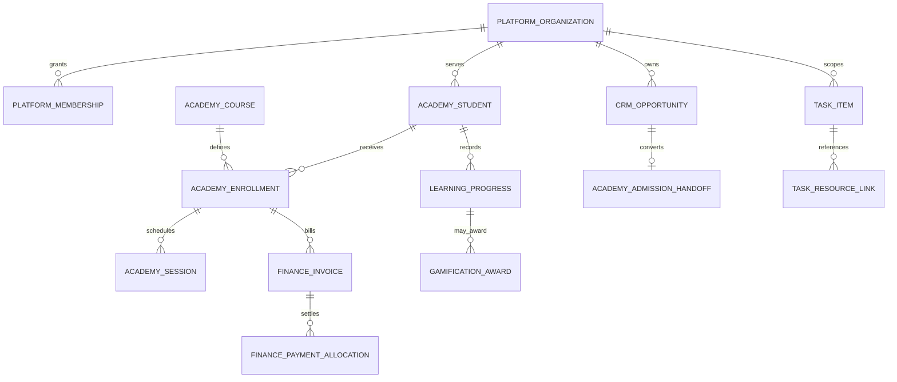

# Robotronix Education Suite — Consolidated Architecture & Release 1 Readiness
Status: **DESIGN CANDIDATE — DO NOT INSTALL ON DEV/PROD**
Branch: `feature/portal-canonical-db-package`

## 0. Scope and evidence

The product is **one integrated Education Suite**, not separately marketed CRM/Academy/Tasks offerings. We preserve all working behavior while redesigning internal boundaries. No table-count target. The abandoned 70-table replacement is not authoritative.

Verified baseline: 167 tables in `public` (80), `connect` (66), `tasks` (21); 302 FKs; 143 RLS policies; 92 custom triggers; 9 scheduled jobs. The repository's `database/packages.json` explicitly marks the current installers **static-validation-only-not-clean-install-certified**. The existing Portal manifest has 13 schema components and 4 reference components.

`database/audit/dev_catalog_snapshot.json` is a **read-only** DEV snapshot of table columns, non-extension function signatures/privileges, RLS policy definitions and trigger names. The CI compatibility gate replays the source inventory against that snapshot. A successful name-match gate does not certify SQL installation, permissions, argument compatibility or runtime behavior.

## 1. Recommended logical data model

These are **conceptual relationships**, not verified physical FKs or approval to rename existing tables. In Release 1 retain current `public.students`, `public.enrollments`, `connect.opportunities`, `tasks.items`, etc. Organisation ownership must be introduced through explicit compatibility mapping, not assumed to exist already.

## 2. Domain boundaries and delivery sequence

| Domain | Authoritative existing objects | Target owner | Delivery |
|---|---|---|---|
| Platform identity | `auth.users`, `public.profiles`, `connect.memberships`, `tasks.accounts` | `platform` adapters, per-org roles | R1 foundation |
| CRM/admissions | `connect.people`, `connect.inquiries`, `connect.opportunities`, handoffs | `crm` (currently `connect`) | R1 |
| Academy | `public.students`, `public.parents`, `public.enrollments`, `public.schedule_events`, `public.class_attendance` | `academy` (compatibility retains `public`) | R1 |
| Tasks | `tasks.items`, `tasks.workspaces`, `tasks.module_links`, `connect.tasks` | `tasks` | R1 |
| Finance/payroll | `public.student_invoices`, `public.student_fee_payments`, `public.trainer_earnings`, `public.trainer_payouts` | `finance` (compatibility retains `public`) | R1 existing |
| Communication | `connect.messages`, WhatsApp outbox, `public.communication_messages`, notifications | `communications` adapter | R1 existing |
| Zoom/integrations | `public.zoom_*`, CRM webhooks, nine Netlify workers | `integrations` adapter | R1 existing |
| Curriculum & LMS | `public.courses`, existing learning notes/projects | `learning` | R2 extension |
| Assessment | `public.quizzes`, `public.quiz_attempts`, `public.learning_observations` | `assessment` | R2 extension |
| Gamification | `public.xp_transactions` | `gamification` | R2 extension |
| Certificates/portfolios | `public.learner_projects`, `public.project_submissions` | `credentials` | R2 |
| Analytics | CRM reports and Portal dashboards | read models, not financial truth | R2 |
| AI/agents | None designated canonical | `automation` with approvals/audit | R3 |
| Branch/resources | `public.delivery_centers`, possible branch model | `operations` | R3 |
| System | `public.portal_audit_log`, logs, job runs, `connect.audit_events` | `system` | R1 preserve |

A logical target owner is **not** a requirement to physically move an object during Release 1. Future domains receive identifiers/relationship and ownership specifications before any DDL.

## 3. Existing-to-target dispositions

Until line-by-line callers and tests are complete, **retain all 167 physical tables unchanged**. The default disposition is `retain-and-wrap`, with each table keeping its actual schema-qualified name and PK. This is a safety policy, not a claim every table has been individually optimized.

Candidate consolidations must be separately justified; particularly **do not** merge `connect.people` with `public.students`, `connect.tasks` with `tasks.items`, CRM tenant memberships with Tasks workspace members, or invoice/payment tables without validating distinct lifecycles and historical rows.

`database/platform/01_additive_foundation.sql` is **a candidate only**, not part of the current installers. It defines `platform.organizations`, `organization_memberships` and `product_entitlements`, but needs a verified mapping for CRM tenant IDs, Tasks workspaces, Portal global roles, user access paths and per-org permissions before adoption. The suite's commercial packaging should be an organisation-level subscription; `product_entitlements` should not be interpreted as a requirement to sell modules separately.

## 4. Physical architecture and compatibility strategy

1. **Baseline freeze:** inventory exact DB objects and source callers; record snapshot hashes and job owners.
2. **Additive-only platform:** introduce organisation identity and membership bridge only when every old role decision has a tested mapping. Existing tables and functions remain active.
3. **Dual-reading compatibility:** old APIs still use the established source-of-truth tables; new views/adapters are added alongside, with no unsynchronised dual writers.
4. **Domain-by-domain migration:** CRM admissions; Academy schedule/attendance; Tasks links; money/communications; only after deep parity and security tests.
5. **Deprecation** only after all callers stop referencing an old object, historical reconciliation passes and rollback is demonstrated. No destructive migration is approved by this document.

## 5. Mandatory invariants

- Authenticated actor ID is derived from a validated token, never accepted as an independent public authority.
- Service-role RPCs enforce actor + organisation + resource permissions internally; RLS alone cannot protect bypass-RLS callers.
- A parent cannot access unrelated students. A trainer sees only assigned learners. CRM tenant boundaries and Tasks private ownership remain enforced.
- An enquiry is not an enrolment until Academy confirms it; acceptance and conversion are idempotent.
- No duplicate invoices, payment receipts, attendance-paid earnings, WhatsApp replies, Zoom reservations or renewal tasks on retry.
- Preserve paid invoice/earning history and unique numbering/receipt constraints; prove financial reconciliation.
- Retain existing scheduling, timezone, Zoom retention, privacy and notification rules.
- Background jobs must have one owner, explicit enablement and idempotent processing.

## 6. Integration contracts

| Producer | Consumer | Event/contract | Gate |
|---|---|---|---|
| CRM | Academy | Demo reservation and admission handoff | explicit CRM membership; Academy confirmation |
| Academy | CRM | Enrollment, renewal and lifecycle summaries | authenticated worker; idempotent upsert |
| CRM | Tasks | CRM task followup and status sync | tenant membership, item ownership |
| Tasks | Academy | Schedule-event task links and notifications | admin/assigned trainer access |
| Academy | Finance | Delivered attendance/session to earning | single-source paid-attendance guard |
| Academy | Zoom | Meeting reservation/reconciliation/retention | provider idempotency, access and security |
| Communications | CRM/Academy | Provider webhook or outbound delivery | signature check, consent, dedupe and retries |
| LMS/Assessments | Gamification | Verified achievement events | immutable event provenance and anti-double-award |
| AI | All | Proposal/summary only initially | permission-scoped retrieval, consent, human approval |

## 7. Test and release gates (not all completed)

- **Static gate:** `node scripts/inventory-db-callers.mjs artifacts/db-call-inventory` then `node scripts/check-db-catalog-compatibility.mjs artifacts/db-compatibility`; outputs exist/missing reference CSVs, *not* contract correctness.
- **Structural/CI:** run existing release, security, schedule, finance, modular deployment, typecheck and integration suites. Previously the Platform contract workflow passed while broader Security and Release workflows failed; investigate those failures, do not weaken checks.
- **Security:** admin/trainer/parent/student; CRM owner/admin/manager/counsellor/viewer; Tasks private/delegated; cross-organisation and revoked-membership negative tests.
- **Finance:** invoice/payment/receipt/payroll fixtures, invoice numbering, no double payment, missing exchange rate behavior.
- **Provider/worker:** Zoom and WhatsApp replay, worker idempotency and retention.
- **Install:** isolated clean database with the existing full-suite installer; run catalog + data + role parity; any missing objects or failing tests block DEV installation.
- **Rollback:** capture backups/restore rehearsal and reversible feature toggles before PROD changes.

## 8. Strict deployment policy and next decision

Do not deploy, execute SQL on DEV/PROD, or merge. Existing canonical packages remain uncertified. No replacement SQL should be called production-ready until isolated clean-install tests, E2E parity and security tests succeed.

The next user approval should be for **installation on DEV** only after the above gates pass and exact migration/rollback scripts are reviewed. Future-module schemas remain design specifications until product rules are clear.
