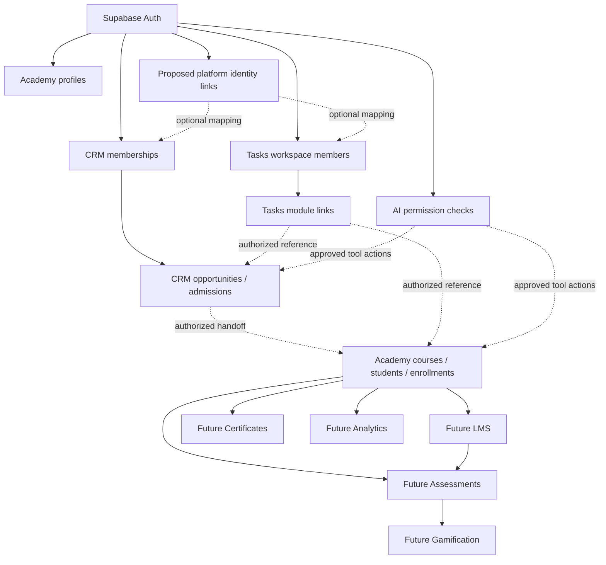

# Robotronix Education Suite — Master Architecture v0.1 (design proposal)
**Basis:** Live DEV catalog inspected 2026-11-14; starting branch commit `7b68bad2cf46c765f3dfcfe9d450965ba2b4e45c`. **Status:** design proposal, not deployed. No DEV or PROD DDL from these files.

## Decisions
1. Preserve 167 existing application tables: 80 `public`, 66 `connect`, 21 `tasks`. Keep historical 70-table rewrite abandoned.
2. `auth.users.id` is the sole authenticated principal; `public.profiles.id` remains the Academy persona. Never equate CRM contact `connect.people.id` with an authenticated user.
3. `connect.tenants.id` is the *existing CRM tenant identifier*, not automatically the platform-wide organization ID. `connect.memberships` owns CRM role authorization; `tasks.workspaces` / `tasks.workspace_members` own Tasks sharing; `public.profiles.role` owns existing Academy role. All remain source-of-truth until an explicitly tested mapping and migration exists.
4. Future `platform.organizations` and `platform.memberships` are a compatibility layer, not an immediate replacement. Use `platform.identity_links` to associate module-specific IDs without overwriting originals; links must be validated for tenant ownership.
5. New learner identities always reference `public.students.id`; course masters reference `public.courses.id`; active enrollments reference `public.enrollments.id`. Parent relationships remain in Academy. CRM contact ↔ learner linking is a separately authorized consent-controlled mapping.
6. Existing `public.projects`, `public.project_submissions`, `public.quizzes`, `public.quiz_attempts`, `public.xp_transactions`, `public.student_invoices`, `public.student_fee_payments`, `public.trainer_earnings` remain canonical Release 1 records. Proposed LMS/Assessments/Gamification/Finance structures are additive only, with explicit mapping to legacy records.
7. Future schemas: `platform`, `lms`, `assessment`, `gamification`, `certificates`, `analytics`, `ai`, `operations`. These names are proposed namespaces, not deployed schemas. Existing `public` Academy/Finance/Classroom and `connect` Communications continue in place.
8. Cross-module ownership: service APIs/RPCs and transactional outbox for business events; direct FK only if both modules are guaranteed installed together. Optional modules must not introduce hard dependencies into base installers.
9. Tenant isolation uses authenticated principal + validated membership + resource ownership; service-role is restricted to server components with explicit actor/tenant checks. No authorization based on mutable user metadata.
10. Privacy: student data minimized; analytics aggregate and scoped; rankings opt-in, access-limited; AI tool actions permission-gated and auditable. Secrets are references to external secret stores, not database plaintext.

## Existing domain boundaries
| Module | Canonical identifiers and objects | Extensions |
|---|---|---|
| Academy | `public.students`, `public.courses`, `public.enrollments`, `public.cohorts`, `public.schedule_events`, `public.class_attendance` | LMS lesson-to-enrollment, assessment targeting |
| CRM | `connect.tenants`, `connect.memberships`, `connect.people`, `connect.opportunities`, `connect.portal_admission_handoffs` | Identity links and domain events |
| Tasks | `tasks.items`, `tasks.workspaces`, `tasks.workspace_members`, `tasks.module_links` | Authorized links and events |
| Finance | `public.student_invoices`, `public.student_fee_payments`, `public.trainer_earnings`, `public.trainer_payouts` | Optional ledger projections, not replacement |
| Learning | `public.projects`, `public.project_submissions`, `public.quizzes`, `public.quiz_attempts`, `public.xp_transactions` | LMS content versioning, new question bank, award rules |
| Classroom | `public.zoom_meetings`, `public.zoom_recordings`, `public.zoom_host_accounts` | Recording links, no new Zoom master |
| Communications | `connect.messages`, `connect.conversations`, `connect.webhook_receipts`, `public.communication_messages` | Provider-neutral events |

## Future schema ownership (proposed)
| Schema | Authoritative entities | Security / lifecycle |
|---|---|---|
| platform | organizations, memberships, identity_links, module_entitlements, domain_events, event_deliveries | internal scope / idempotent outbox |
| lms | course_modules, lessons, lesson_versions, content_assets, lesson_progress, submission_links | scoped enrollment permissions, immutable published versions |
| assessment | question_banks, questions, question_versions, assessments, assessment_questions, attempts, responses | immutable attempt snapshots, owner-only grading |
| gamification | award_rules, xp_awards, badges, badge_awards, streak_state | dedupe sources; opt-in rankings; historic audit |
| certificates | templates, credentials, credential_events | verification token hashes, revocation |
| analytics | metric_definitions, metric_snapshots, refresh_runs | aggregate access, bounded retention |
| ai | agents, prompt_versions, conversations, tool_grants, executions, usage_events | least privilege, human approval for writes |
| operations | facilities, equipment, stock_movements, allocations, maintenance_work_orders | institution-scoped, inventory ledger |

## Relationship diagram

## Migration principles
- Stage 0: keep Release 1 contracts unchanged and finish role-negative tests.
- Stage 1: install future modules independently behind flags, no backfill of historical data until reconciled.
- Stage 2: build read-only module mappings with tenant checks; compare counts and sample records.
- Stage 3: dual-read / shadow projections as needed; never dual-write financial ledgers without deduplication.
- Stage 4: backfill once, emit reconciliation and rollback evidence; switch APIs only after compatibility tests.
- Stage 5: deprecate legacy contracts only after consumers and external integrations have migrated.

## Release 1 impact / unresolved gates
No proposed DDL below is included in `database/packages.json` or installed in DEV. Identity migration, live RLS positive/negative role tests, full application E2E, provider sandbox checks, versioned migration strategy, and performance workload evidence remain open. This design reduces disruptive future change but does not promise zero future migrations.
